# LedgerLens

An accounting document assistant built with Python, FastAPI and a plain JavaScript interface. Upload an invoice or statement, ask a question, and inspect the document page behind the answer.

The application supports native and scanned PDFs, PNGs and JPEGs. It combines hybrid retrieval for general questions with deterministic accounting functions for totals and overdue checks. The model interprets documents; Python calculates supported financial results.

## Run the application

You need an OpenAI API key. Model calls incur API charges. Choose Docker for the simplest setup, or use the native Python instructions below. Neither option requires a frontend development server.

### Option 1: Docker

Prerequisite: Docker with Compose.

```sh
git clone https://github.com/sanya28wd/ledgerlens-accounting-rag.git
cd ledgerlens-accounting-rag
cp .env.example .env
```

Set these values in `.env`:

```dotenv
OPENAI_API_KEY=your-openai-api-key
REVIEWER_KEY=your-long-random-workspace-key
```

Generate a reviewer key with `python3 -c 'import secrets; print(secrets.token_urlsafe(32))'`. Keep the other settings from `.env.example`.

```sh
docker compose up --build
```

Open **http://localhost:8000**, choose **Unlock workspace**, and enter your `REVIEWER_KEY`. Docker installs Tesseract and its English OCR data. A named volume preserves uploads and the database between container restarts. Stop with `docker compose down`; adding `--volumes` deletes that stored data.

### Option 2: Native Python

Prerequisites: Python 3.12, [uv](https://docs.astral.sh/uv/), and Tesseract with English language data. Node.js 22 is only needed for frontend checks.

```sh
git clone https://github.com/sanya28wd/ledgerlens-accounting-rag.git
cd ledgerlens-accounting-rag

# macOS
brew install tesseract
# Ubuntu/Debian instead:
# sudo apt-get install tesseract-ocr tesseract-ocr-eng

uv sync --frozen
cp .env.example .env
# Set OPENAI_API_KEY and REVIEWER_KEY as described above.
uv run uvicorn app.main:create_application --factory --host 127.0.0.1 --port 8000
```

Open **http://localhost:8000** and unlock the workspace. Do not overwrite an existing `.env` when updating a checkout. If port 8000 is occupied, choose another port with `--port`.

### Configuration

| Variable | Purpose / default |
| --- | --- |
| `OPENAI_API_KEY` | Required for document processing and model-backed questions; backend only. |
| `REVIEWER_KEY` | Shared workspace access key; minimum 16 characters. |
| `CHAT_MODEL` | Structured extraction, intent and general answers: `gpt-6-luna`. |
| `EMBEDDING_MODEL` | Query and document embeddings: `text-embedding-3-small`. |
| `EMBEDDING_DIMENSIONS` | `1536`; must match the stored index. |
| `DATA_DIR` | `./data` locally; Compose sets `/var/data`. |
| `ALLOWED_ORIGINS` | JSON list of permitted frontend origins; local defaults are in `.env.example`. |
| `TESSDATA_PREFIX` | Optional path to local Tesseract language data if automatic discovery fails. |

The interface opens without an OpenAI key, but processing and model-backed questions return an explicit configuration error. No simulated answers are substituted. Unlock credentials stay in tab memory; refreshing requires unlocking again.

The repository is private, so the evaluator needs GitHub access before cloning. `.env` and runtime data are intentionally excluded: each evaluator supplies their own keys, and processing creates a fresh local index. Never commit `.env`.

## Try the four assignment questions

Click **Load samples** once and wait for documents to become **Ready**. This loads three Cedar invoices, one Nova invoice and an October statement. Newly ready documents are selected automatically: adjust the selection for each question below. All samples are fictional.

| Select | Ask | Expected result |
| --- | --- | --- |
| `cedar-001.pdf` | What is the invoice number, date, vendor, and total amount on this invoice? | CED-001; 2026-09-15; Cedar Supplies; AED 1,200.00. |
| All three `cedar-*.pdf` invoices, excluding the scan | What is the total amount invoiced by Cedar Supplies? | AED 2,500.00 across three invoices, including the paid invoice. |
| Three Cedar invoices and `nova-001.pdf`; set **As of** to **2026-10-31** | Which invoices are overdue? | CED-001 and NOV-001 confirmed overdue; CED-003 paid; CED-002 not yet due. Nova has USD 40.00 outstanding. |
| `october-statement.pdf` only | Summarise the expenses recorded in this statement. | AED 400.00; transfers, deposits and balances excluded. |

Click a citation to inspect the excerpt and open the original page. Then select `cedar-001.pdf` and ask **“What is Cedar Supplies' bank account number?”** The answer should acknowledge that the information is missing.

Additional uploads in [samples/](samples/):

- `cedar-scan.pdf` / `cedar-scan.png`: OCR examples containing the same CED-001 invoice. Duplicate financial records are counted once, with disclosure.
- `atlas-unknown.pdf`: past due date but no payment evidence; its payment status remains unknown.
- `two-invoices.pdf`: two Bundle Office invoices on separate pages, totaling AED 125.00.
- `multipage-invoice.pdf`: one Horizon invoice spanning two pages, totaling AED 100.00.
- `mixed-pages.pdf`: native text and a scanned page in one PDF.
- `scale/`: 24 Aurora Paper invoices totaling AED 246.00, used to verify aggregation beyond retrieval limits.

Retry and delete actions are available in the document library. Loading the same exact file twice returns a duplicate-file error. Sample generation is reproducible with `uv run python -m scripts.generate_samples`.

## Architecture and design note

Diagram links: [high-level design](#high-level-design) · [ingestion flow](#ingestion-flow) · [answering flow](#answering-flow). The original Archify diagrams are embedded below as SVGs. Each also has a standalone interactive HTML version: download it and open it in a browser. No presentation site or recording material is included.

### High-level design



[View full-size diagram](docs/diagrams/high-level.svg) · [Download interactive Archify diagram](docs/diagrams/high-level.html)

I kept one modular application rather than introducing microservices or a message broker. SQLite holds document states, extracted pages, accounting records, chunks and embeddings. FTS5 handles BM25 keyword search; sqlite-vec supplies cosine distance for exact filtered vector scanning. One database keeps processed-data publication transactional and setup small. This is suitable for the assignment's corpus, not a large-scale approximate-nearest-neighbor service.

### Ingestion flow



[View full-size diagram](docs/diagrams/ingestion.svg) · [Download interactive Archify diagram](docs/diagrams/ingestion.html)

`ingestion.py` orchestrates these steps; arrows represent execution/data handoffs, not helper-to-helper imports. PyMuPDF extracts native text and positional blocks. Tesseract handles scanned pages and image regions on mixed pages. OCR runs in a separate, killable process with a 180-second extraction timeout.

Chunks never cross pages, preserving document/page provenance. Line boundaries are retained where possible; oversized lines can split. The target is 500 tokens with up to 75 tokens of overlap, rather than a guarantee of fixed-size chunks or intact table rows.

The API acknowledges an upload before processing. One worker processes queued documents sequentially. Failed documents do not enter search. Queued jobs survive a restart; interrupted processing is marked failed for explicit retry. All processed data is committed before the document becomes ready.

### Answering flow



[View full-size diagram](docs/diagrams/answering.svg) · [Download interactive Archify diagram](docs/diagrams/answering.html)

Vector search finds passages with similar meaning; BM25 helps with specific terms and identifiers. Reciprocal Rank Fusion combines rank positions using `1 / (60 + rank)`, avoiding direct addition of incompatible similarity scores. Both searches are restricted to the selected documents. General answers receive up to eight passages. If evidence is insufficient, the application checks all selected text when it fits the 24,000-token context budget; otherwise it reports incomplete coverage and asks for a narrower scope.

Accounting operations use **all selected extracted records**, independent of top-k retrieval. This avoids calculating an incomplete vendor total merely because some invoices ranked below the search cutoff.

### Why these tools and settings

- **FastAPI and Pydantic:** typed request/response contracts and generated API documentation keep the backend straightforward to inspect. Plain JavaScript avoids a separate frontend framework and build requirement for local use.
- **GPT-6 Luna:** used for language interpretation and schema-constrained extraction/generation. Accounting arithmetic stays in Python. The model is configurable so the evaluator can use a model available to their account; the submitted results apply to the recorded default, not every replacement model.
- **text-embedding-3-small:** provides embeddings for both questions and chunks through the same provider connector. Model and dimension checks prevent mixing incompatible vectors in an existing index.
- **500-token chunks with up to 75 overlap:** a practical starting point that balances local context with a bounded answer prompt. Page boundaries preserve citations; overlap carries some neighboring context. These values were not exhaustively optimized, and large tables may need a different approach.
- **One worker, local OCR and SQLite:** keep setup and state management small. The trade-off is limited throughput and single-instance operation, rather than distributed processing.

### Accounting and grounding decisions

- Monetary values are decimal strings; calculations use Python `Decimal`. Each currency is reported separately, without conversion.
- Gross vendor totals include paid invoices and exclude credit notes with disclosure. Missing amounts/currencies produce exclusions and an incomplete subtotal where appropriate.
- Duplicate identity is normalized vendor + invoice number + document kind. Matching versions count once; conflicting versions are excluded. Vendor normalization uses case and whitespace, not speculative entity matching.
- A past due date alone does not establish unpaid debt. Confirmed overdue classification requires payment evidence; unknown status remains unknown. An explicit, unambiguous question date overrides the date picker. The default date uses Asia/Dubai.
- Expense summaries process verified debit rows from one statement, excluding transfers, deposits, balances and unresolved rows. Multiple statements require clarification to avoid overlapping-period double counting.
- Non-null extracted fields require matching page excerpts and additional value checks. Ambiguous dates and currencies remain unresolved. Documents with unresolved accounting fields can still support general questions, with visible issues.
- Pydantic constrains response structure. Source-ID checks reject invented references; excerpt checks establish that text exists on a page. Neither guarantees semantic correctness. Document content is treated as untrusted evidence.

Diagrams were created with [Archify](https://github.com/tt-a1i/archify). The exported assets retain its embedded software notices. The high-level view shows runtime boundaries; the low-level views show ingestion and answering steps.

### Code map

| Location | Responsibility |
| --- | --- |
| `app/main.py` | Application lifecycle, authentication, HTTP endpoints and local static interface. |
| `app/ingestion.py`, `app/extract.py` | Background processing and isolated native/OCR extraction. |
| `app/chunking.py`, `app/evidence.py` | Page-aware splitting and accounting evidence validation. |
| `app/retrieval.py` | Hybrid retrieval and rank fusion. |
| `app/answers.py`, `app/accounting.py` | Question routing, general answers and deterministic financial operations. |
| `app/storage.py`, `app/provider.py` | SQLite/filesystem and OpenAI connectors. |
| `app/models.py`, `app/config.py`, `app/errors.py` | Typed contracts, environment settings and explicit errors. |
| `web/` | Plain HTML/CSS/JavaScript interface, checked with strict TypeScript/JSDoc. |
| `scripts/`, `tests/`, `samples/` | Evaluations, fixture generation and automated checks. |

## API and error handling

Interactive API documentation is available at **http://localhost:8000/docs**. All `/api/*` routes require `Authorization: Bearer <REVIEWER_KEY>`; `/health`, the interface and fictional sample files are public. Uploaded originals are protected.

| Endpoint | Purpose |
| --- | --- |
| `POST /api/documents` | Multipart `file`; returns HTTP 202 with queued document ID. |
| `GET /api/documents` | List documents and processing state. |
| `GET /api/documents/{id}` | Document metadata and accounting records. |
| `GET /api/documents/{id}/pages` | Cached text, page numbers, OCR flags and coordinates. |
| `GET /api/documents/{id}/file` | Original PDF/image. |
| `POST /api/documents/{id}/retry` | Retry a failed job. |
| `DELETE /api/documents/{id}` | Remove original and indexed data; busy documents return 409. |
| `POST /api/chat` | Ask a question about selected document IDs. |
| `GET /api/status` | Provider/OCR readiness and upload limits. |
| `GET /health` | Application/worker readiness. |

Example chat body; use IDs returned by upload/list:

```json
{
  "question": "What is the total amount invoiced by Cedar Supplies?",
  "document_ids": ["replace-with-document-id"],
  "history": [],
  "as_of": "2026-10-31"
}
```

Answers include status, claims, sources, optional contribution rows, issues, reference date and coverage. Errors contain `code`, `message` and `request_id`.

Uploads are limited to **10 MiB and 25 pages**, with matching file signatures/extensions. Empty, unsupported, corrupt, encrypted and unreadable documents receive actionable errors. Extraction input is limited to 24,000 tokens and structured extraction output to 16,000 tokens; oversized or incomplete output fails explicitly. Transient provider failures receive at most three attempts with backoff and warning logs. Authentication and other non-transient failures are surfaced directly.

## Tests and evaluation

### Local checks

```sh
uv sync --frozen
npm ci
uv run ruff check app scripts tests
uv run mypy app scripts tests
npm run check
uv run pytest -q
```

**15 local tests passed.** They use real SQLite, vector search, native PDF extraction and OCR, alongside focused accounting, evidence and ranking-metric checks. They cover duplicates, conflicting invoices, missing currency, overdue semantics, statement exclusions, multiple invoices/continuation pages, interrupted jobs, access control and invalid uploads. The 24-invoice test verifies aggregation beyond retrieval limits. Docker OCR and restart persistence were also verified. Full browser/mobile interaction coverage is not claimed.

### Real-model end-to-end evaluation

Use the **native Python setup** for the complete evaluation sequence below, with the backend and scripts using the same `.env` and `DATA_DIR`. The retrieval and faithfulness scripts read that local database directly. Docker keeps its database in a separate named volume; these scripts do not inspect that volume automatically. Evaluators using Docker can still try every application feature through the UI.

Start the app, then run:

```sh
uv run python -m scripts.evaluate --url http://localhost:8000
```

This uploads required fictional fixtures, waits for ingestion and runs [11 specified cases](samples/evaluation.json). It checks expected status, case-insensitive expected facts, expected source-page coverage and whether excerpts exist on their cited pages. These checks do not prove every statement is entailed.

The saved run passed **11/11 cases**: seven accounting, two retrieval/partial-answer and two abstention cases. All nine source-bearing responses included their expected pages. Rerunning the script writes the full report to `evaluation-results.json`.

### Retrieval comparison

After the end-to-end run has populated the configured local database:

```sh
uv run python -m scripts.evaluate_retrieval
```

[12 labeled questions](samples/retrieval-evaluation.json) compare BM25, vector search and hybrid RRF across the same nine files / eleven pages. Each search retrieves up to 20 candidates; each method has an eight-chunk final budget. Pages are deduplicated after selection. Binary page-level metrics are macro-averaged at k = 1, 3, 5 and 8; Precision@k counts unfilled positions against precision.

| Method | Precision@1 | Recall@3 | Recall@5 | MRR@8 | nDCG@8 |
| --- | --- | --- | --- | --- | --- |
| BM25 | 0.750 | 0.896 | 1.000 | 0.854 | 0.896 |
| Vector | 0.750 | 0.938 | 0.958 | 0.861 | 0.865 |
| Hybrid RRF | 0.833 | 0.854 | 1.000 | 0.896 | 0.912 |

Hybrid had the strongest first-result and overall ranking scores on this diagnostic set; vector had better Recall@3. No parameters were tuned against these results. This small synthetic dataset does not establish general superiority. Rerunning writes all per-question rankings and metrics to `retrieval-evaluation-results.json`. Metric definitions follow [Introduction to Information Retrieval](https://nlp.stanford.edu/IR-book/html/htmledition/evaluation-of-ranked-retrieval-results-1.html).

### Advisory faithfulness review

```sh
uv run python -m scripts.evaluate_faithfulness
```

This reviews the four saved general-RAG/abstention responses, rather than regenerating them. The rubric checks each claim against its cited excerpts, question relevance and missing-information handling. Three deliberately faulty controls test invented bank details, insufficient citation support and unnecessary refusal; expected verdicts are hidden from the judge.

The judge accepted **4/4 saved responses** and rejected **3/3 controls**. The judge uses the configured chat model, so correlated errors remain possible. These are advisory judgments requiring human review, not a guarantee of faithfulness. The generated `faithfulness-evaluation-results.json` includes inputs, rubric and individual reasons.

All model evaluations incur API usage. Retrieval uses one batch of query embeddings; faithfulness makes seven judge requests. Reruns write ignored root-level JSON reports. The results above were observed using `gpt-6-luna` and `text-embedding-3-small`; saved reports are included below. New runs still write ignored root-level reports, preserving the submitted snapshots. Run the end-to-end evaluation first to produce the saved answers needed by the faithfulness review.

Saved evaluation reports:

- [End-to-end results](evaluations/end-to-end.json): all eleven cases, generated answers and citation checks.
- [Retrieval comparison](evaluations/retrieval.json): per-question BM25, vector and hybrid rankings, plus aggregate metrics.
- [Advisory faithfulness review](evaluations/faithfulness.json): rubric, reviewed inputs, reasons and deliberately faulty controls.

These reports contain fictional sample data. The model-based judgments remain advisory; they do not establish guaranteed claim support.

## Requirement coverage

| Assignment requirement | Implementation |
| --- | --- |
| Upload and manage PDFs | Upload, list, retry, delete and protected previews; PNG/JPEG supported too. |
| Native text and scanned documents | PyMuPDF plus local English Tesseract OCR. |
| Chunking, embeddings and vector retrieval | Page-contained chunks, OpenAI embeddings, sqlite-vec and BM25 hybrid search. |
| Natural-language questions | Chat UI and documented API with bounded conversation history. |
| Grounded answers and missing information | Document/page/excerpt citations, evidence validation, partial answers and abstention. |
| Four accounting examples | Invoice fields, overdue classification, statement expenses and complete selected-record vendor totals. |
| Maintainable structure and errors | Separate ingestion/retrieval/generation/accounting modules, typed models and explicit failure states. |
| Runnable code, samples and design note | Setup above, fictional fixtures, architecture diagrams, decisions, tests and limitations in this README. |

## Limitations and next improvements

This is one protected shared workspace with one ingestion worker, not a multi-tenant product. English printed OCR is supported; handwriting, complex tables and unusual layouts can cause omissions or misinterpretation. Field validation cannot detect every missing row. Statement categories are model-interpreted; no automatic reconciliation, currency conversion or credit-note netting is performed. Chat history is not durable. Exact vector scanning and local SQLite limit scale.

The next improvements would be a source-linked correction screen for extracted fields, statement balance reconciliation, and a larger independently labeled corpus with varied layouts and scan quality. These would improve accounting review before introducing more infrastructure.

Changing the embedding model/dimensions requires a fresh compatible index. Stop the app, archive the existing data directory, start with a new directory and re-upload documents. Startup rejects incompatible index configuration rather than mixing vectors.

## Optional hosting: Vercel + Render

The included `vercel.json`, `render.yaml` and frontend build script support a static Vercel interface with a Render Docker backend. Hosting is optional; local setup above remains the submission's verified runtime.

1. On Render, connect this private repository and create a Blueprint from `render.yaml`. The single-instance service uses Render’s free plan without a persistent disk. Uploads and database changes are lost on restarts or redeploys, and the service sleeps after inactivity.
2. Supply backend `OPENAI_API_KEY`, a long random `REVIEWER_KEY`, and `ALLOWED_ORIGINS` as a JSON list of exact permitted frontend origins. Keep one service instance and the Dockerfile's one-worker command. Verify the deployed `/health` endpoint.
3. Import this repository into Vercel. Use framework preset Other, root directory `.`, install command `npm ci`, build command `npm run build`, and output directory `dist`.
4. Set Vercel `PUBLIC_API_URL` to the backend's HTTPS base URL, without `/api`. This value is public. Never put the OpenAI or reviewer key in the frontend build environment.
5. Set Render `ALLOWED_ORIGINS` to the exact Vercel production origin, for example `["https://your-project.vercel.app"]`, and redeploy the backend.
6. Unlock the hosted interface, process a sample, ask a question, inspect a citation and verify the backend responds after waking from inactivity. Local uploads are not transferred automatically.

For a local static-build check: `PUBLIC_API_URL=https://example.onrender.com npm run build`. GitHub deployment integrations must be granted access to the private repository. Keep `.env` and hosting access tokens out of Git.
